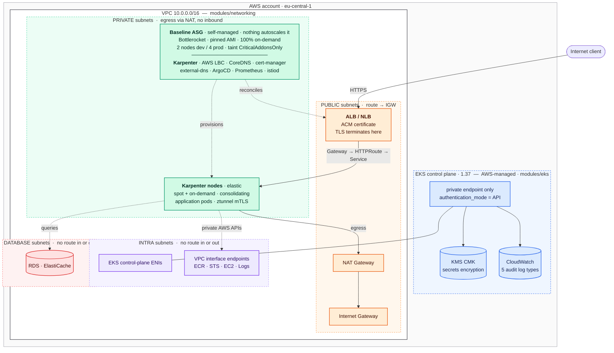
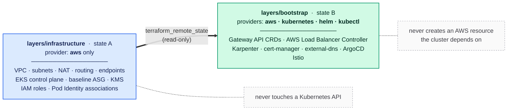
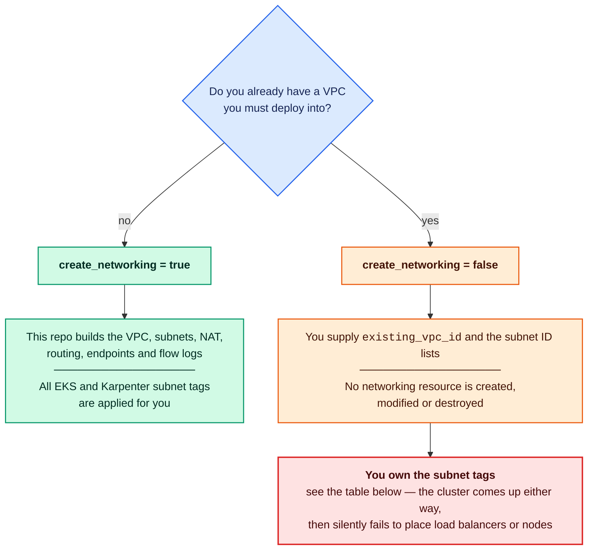

# terraform-eks-cluster

Production-grade, reusable Terraform for Amazon EKS.

Provision **networking + EKS**, or **EKS alone on a VPC you already own**, from
the same code. North-south traffic uses the **Kubernetes Gateway API** backed by
the AWS Load Balancer Controller — not ingress-nginx.

[](https://github.com/pramodksahoo/terraform-eks-cluster/actions/workflows/validate.yml)

---

## Contents

- [What you get](#what-you-get)
- [Architecture at a glance](#architecture-at-a-glance)
- [Repository layout](#repository-layout)
- [The two-layer model](#the-two-layer-model)
- [Do I need the networking module?](#do-i-need-the-networking-module)
- [Quick start](#quick-start)
- [Module catalogue](#module-catalogue)
- [Versioning](#versioning)
- [Multi-account](#multi-account)
- [Multi-region](#multi-region)
- [Security posture](#security-posture)
- [Development](#development)
- [Documentation](#documentation)

---

## What you get

| | |
|---|---|
| **Kubernetes** | 1.37, EKS standard support |
| **Compute** | Self-managed Bottlerocket ASG (pinned AMI) as the baseline floor + Karpenter for all elastic capacity. No managed node groups, no Cluster Autoscaler |
| **Ingress** | Gateway API v1.6.0 via AWS Load Balancer Controller — ALB and NLB `GatewayClass`es, ACM certificates |
| **Identity** | EKS Pod Identity throughout. No IRSA, no static credentials, no long-lived keys |
| **Access** | `authentication_mode = "API"` access entries. The `aws-auth` ConfigMap is gone |
| **Mesh** | Optional Istio in ambient or sidecar mode |
| **Add-ons** | cert-manager, external-dns, metrics-server, ArgoCD, kube-prometheus-stack, gp3 StorageClass |
| **Networking** | Four subnet tiers, optional VPC endpoints, flow logs, IPv6-ready |
| **Region** | `eu-central-1` by default, multi-region ready |

---

## Architecture at a glance



| Colour | Tier | Reachable from the internet? |
|---|---|---|
| 🟠 orange | **public** | Yes — inbound via IGW. Only load balancers and NAT live here |
| 🟢 green | **private** | Outbound only, through NAT. All nodes and pods |
| 🟣 purple | **intra** | No route in or out. Control-plane ENIs and VPC endpoints |
| 🔴 red | **database** | No route in or out. RDS and ElastiCache |

---

## Repository layout

```
modules/            Reusable, independently versioned modules
  networking/         VPC, subnets, routing, NAT, IGW, endpoints, flow logs
  eks/                Cluster, baseline ASG, KMS, Pod Identity, Karpenter IAM
  eks-gateway/        Gateway API CRDs, AWS LBC, GatewayClasses, Gateways
  eks-addons/         Karpenter, cert-manager, external-dns, ArgoCD, monitoring
  istio/              Ambient or sidecar service mesh

layers/             Opinionated compositions — this is what you run
  infrastructure/     AWS resources only (networking + EKS)
  bootstrap/          In-cluster resources (gateway, add-ons, mesh)

environments/       Per-environment backend configs and tfvars
  dev/  prod/

docs/               Architecture, migration guides, ADRs
```

---

## The two-layer model

Terraform cannot reliably configure a `kubernetes` or `helm` provider from
resources created in the same apply. The provider block is evaluated before the
graph is walked, so a cluster endpoint that does not exist yet produces
`Invalid provider configuration` on the first run and
`Provider configuration not present` on destroy.

The fix is a hard split:



`infrastructure` never touches a Kubernetes API. `bootstrap` never creates an
AWS resource that the cluster depends on. Each applies and destroys cleanly in
isolation, and you can rebuild the add-on stack without going near the cluster.

See [ADR-002](docs/adr/002-two-layer-state-split.md).

---

## Do I need the networking module?



When `create_networking = false`, **you** must tag the subnets or the cluster
will come up and then silently fail to place load balancers or Karpenter nodes:

| Tag | On | Failure if missing |
|---|---|---|
| `kubernetes.io/role/elb = 1` | Public subnets | `could not find any suitable subnets for creating the ALB` |
| `kubernetes.io/role/internal-elb = 1` | Private subnets | Same, on an internal Gateway |
| `karpenter.sh/discovery = <cluster_name>` | Private subnets | NodeClaims stay `Pending` with no events |

`terraform output tag_requirements_for_existing_subnets` prints exactly what to
apply for your cluster. The layer also runs `check` blocks that fail the plan
if the subnet lists are empty or the VPC ID is unset.

---

## Quick start

### Prerequisites

| Tool | Version |
|---|---|
| Terraform | `>= 1.10` (developed on 1.17) |
| AWS CLI | `>= 2.x`, configured for the target account |
| `kubectl` | within one minor of 1.37 |

An S3 bucket and DynamoDB table for state must already exist. Create them once
per account, outside this repo — a state backend should never be managed by the
state it holds.

### 1. Infrastructure

```bash
cd layers/infrastructure

terraform init -backend-config=../../environments/dev/infrastructure.backend.hcl
terraform plan  -var-file=../../environments/dev/infrastructure.tfvars
terraform apply -var-file=../../environments/dev/infrastructure.tfvars
```

To reuse an existing VPC, start from
[`environments/dev/infrastructure.existing-vpc.tfvars.example`](environments/dev/infrastructure.existing-vpc.tfvars.example).

### 2. Bootstrap

```bash
cd ../bootstrap

terraform init -backend-config=../../environments/dev/bootstrap.backend.hcl
terraform apply -var-file=../../environments/dev/bootstrap.tfvars
```

### 3. Connect

```bash
cd ../infrastructure
eval "$(terraform output -raw kubeconfig_command)"
kubectl get nodes
kubectl get gatewayclass
```

> Edit the `CHANGE-ME` placeholders in `environments/*/` before your first run.
> Nothing in this repository contains a real account ID, bucket name or domain.

---

## Module catalogue

| Module | Purpose | Docs |
|---|---|---|
| [`networking`](modules/networking) | VPC, four subnet tiers, NAT, IGW, route tables, VPC endpoints, flow logs | [README](modules/networking/README.md) |
| [`eks`](modules/eks) | Cluster, self-managed Bottlerocket ASG, KMS, access entries, Pod Identity, Karpenter IAM | [README](modules/eks/README.md) |
| [`eks-gateway`](modules/eks-gateway) | Gateway API CRDs, AWS Load Balancer Controller, ALB/NLB GatewayClasses | [README](modules/eks-gateway/README.md) |
| [`eks-addons`](modules/eks-addons) | Karpenter, cert-manager, external-dns, metrics-server, ArgoCD, monitoring | [README](modules/eks-addons/README.md) |
| [`istio`](modules/istio) | Ambient or sidecar service mesh | [README](modules/istio/README.md) |

Every module is usable on its own. `modules/eks` does not require
`modules/networking`; it takes subnet IDs.

---

## Versioning

Modules live in this monorepo and are released with **tag prefixes**, so each
one versions independently:

```
networking-v1.0.0
eks-v1.2.0
eks-gateway-v1.0.1
eks-addons-v1.0.0
istio-v1.0.0
```

Consume a module by tag — never by branch:

```hcl
module "networking" {
  source = "git::https://github.com/pramodksahoo/terraform-eks-cluster.git//modules/networking?ref=networking-v1.0.0"
  # ...
}
```

`?ref=main` makes your infrastructure change when somebody else merges a PR.

Semantics are standard semver: **major** for a breaking input/output change or
a resource replacement, **minor** for new optional inputs, **patch** for fixes
and documentation. See [CONTRIBUTING.md](CONTRIBUTING.md).

---

## Multi-account

Every layer accepts `assume_role_arn`, `assume_role_external_id` and
`allowed_account_ids`. Run the same code against any account by pointing at a
different tfvars file:

```hcl
assume_role_arn     = "arn:aws:iam::111122223333:role/terraform-deploy"
allowed_account_ids = ["111122223333"]
```

`allowed_account_ids` is the guard that matters. If the credentials in your
shell resolve to a different account, Terraform refuses before it plans — which
is what stands between a tired engineer and applying a dev plan to production.

`bootstrap` separately accepts `infrastructure_state_role_arn` for the case
where state lives in a shared account but the cluster does not.

---

## Multi-region

`eu-central-1` is the default, and every module is region-agnostic: nothing
hardcodes a region, an AZ or an AMI. To add a region, add an environment
directory with its own backend key and `region`.

Deliberately **not** done yet, because each needs a design decision rather than
a variable: cross-region VPC peering or Transit Gateway, multi-region ACM
certificate replication, Route 53 latency or failover records, and the choice
between a global ArgoCD control plane and one per region.

If a second region is on your roadmap, set Istio's `mesh_id` and `network`
explicitly from day one — they cannot be changed later without a full mesh
restart.

---

## Security posture

| Control | Default |
|---|---|
| API endpoint | **Private.** Public access opt-in, and `0.0.0.0/0` is rejected by variable validation |
| Secrets encryption | Customer-managed KMS key, automatic rotation |
| Audit logging | All five control-plane log types to CloudWatch |
| IMDS | `http_tokens = required`, hop limit 1 — a compromised pod cannot reach the node role |
| Node IAM | Least privilege. No `AmazonS3FullAccess`, no wildcard policies |
| Workload IAM | Pod Identity, scoped per service account |
| EBS | Encrypted by default, gp3 |
| Node OS | Bottlerocket. No SSH, no shell, no package manager; read-only dm-verity root; admin access via SSM only |
| Node AMI | Pinned to an explicit Bottlerocket version, never `latest` |
| Node disks | Both OS and data EBS volumes encrypted. No SSH key, no public IP, private subnets only |
| Secrets in state | None. No password variables; generated credentials are read from the cluster |
| Flow logs | Optional, off by default (cost), on in the prod example |

See [SECURITY.md](SECURITY.md).

---

## Development

```bash
pre-commit install          # fmt, validate, tflint, terraform-docs, trivy
terraform fmt -recursive
```

CI validates every module, layer and example on each PR, and fails if the
generated documentation tables are stale. Input and output tables are produced
by `terraform-docs` — edit the variable descriptions, not the README tables.

---

## Documentation

| Document | Contents |
|---|---|
| [docs/architecture.md](docs/architecture.md) | How the layers, modules and traffic paths fit together |
| [docs/gateway-api-migration.md](docs/gateway-api-migration.md) | Moving from ingress-nginx / Ingress to Gateway API |
| [docs/adr/](docs/adr) | Why each significant decision was made |
| [CONTRIBUTING.md](CONTRIBUTING.md) | Workflow, conventions, release process |
| [SECURITY.md](SECURITY.md) | Threat model, controls, reporting |

---

## License

MIT. See [LICENSE](LICENSE).
