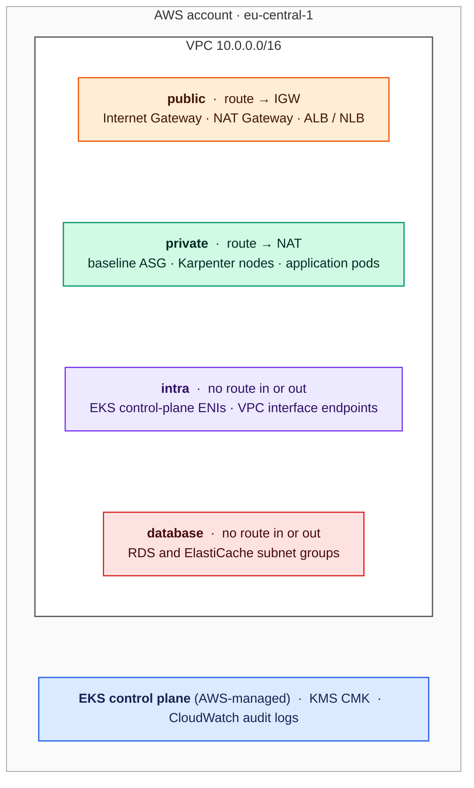
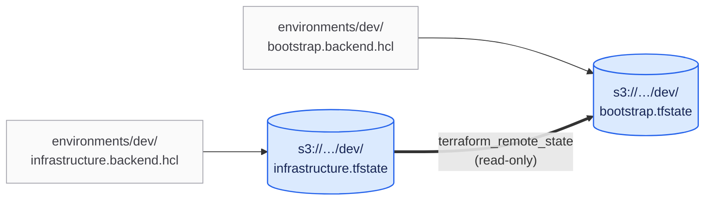
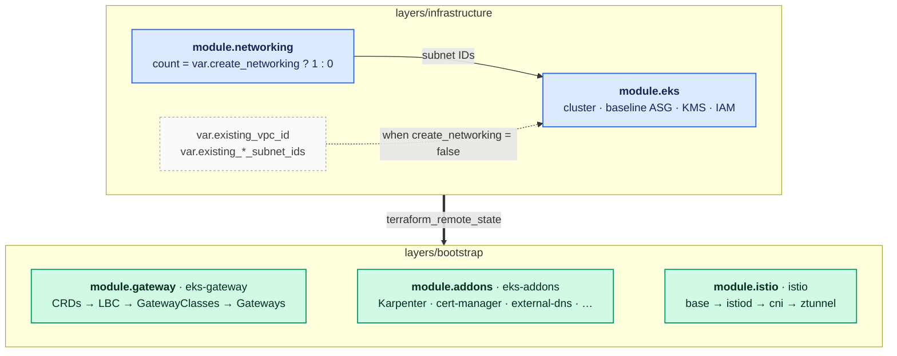
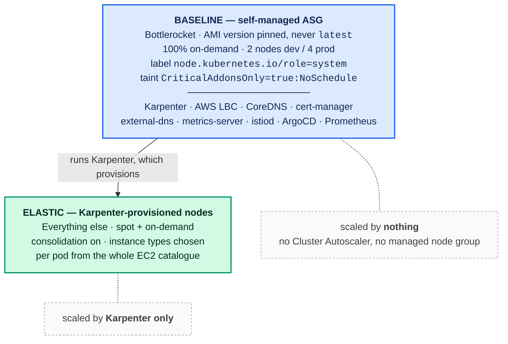
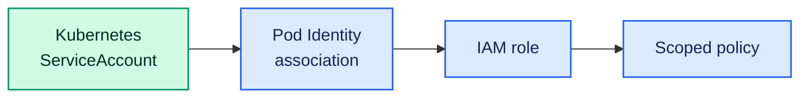
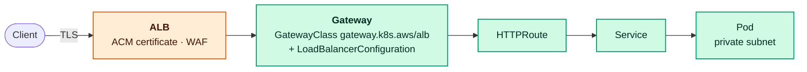
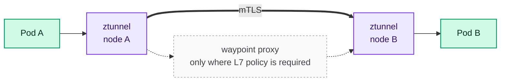
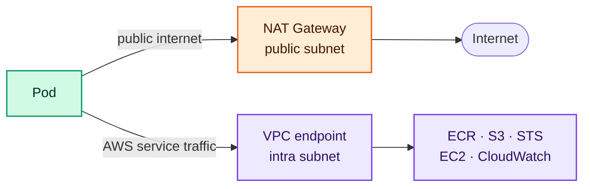
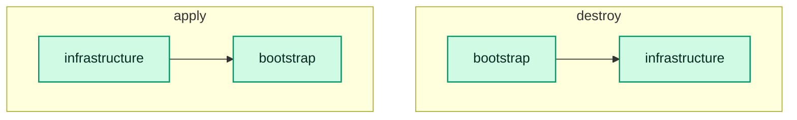

# Architecture

How the layers, modules and traffic paths fit together.

- [Overview](#overview)
- [State architecture](#state-architecture)
- [Network design](#network-design)
- [Compute](#compute)
- [Identity](#identity)
- [Traffic paths](#traffic-paths)
- [Add-on stack](#add-on-stack)
- [Failure domains](#failure-domains)
- [Apply and destroy order](#apply-and-destroy-order)

---

## Overview



The full end-to-end picture, including traffic paths, is in the
[root README](../README.md#architecture-at-a-glance).

---

## State architecture

Two root modules, two state files. The reasoning is in
[ADR-002](adr/002-two-layer-state-split.md).



`layers/infrastructure` declares **only** the `aws` provider.
`layers/bootstrap` declares `aws`, `kubernetes`, `helm` and `kubectl`, and
builds the latter three from remote state using the `aws eks get-token` exec
plugin — so no bearer token is ever persisted.

### Module composition



---

## Network design

Four tiers, one subnet per tier per AZ.

| Tier | Route to | Purpose | Why separate |
|---|---|---|---|
| **public** | IGW | NAT gateways, internet-facing ALB/NLB | Only tier with a public route |
| **private** | NAT | Nodes and pods | Egress without ingress |
| **intra** | *none* | Control-plane ENIs, VPC interface endpoints | Survives a NAT outage; no data transfer charges |
| **database** | *none* | RDS, ElastiCache | No internet path in either direction |

Placing the EKS control-plane ENIs and the VPC interface endpoints in **intra**
is deliberate. If NAT capacity is exhausted or a NAT gateway fails, the API
server ENIs and the endpoints that nodes use to reach ECR, STS and EC2 are
unaffected — the cluster degrades instead of stopping.

### CIDR allocation

Subnets are carved deterministically:

```
index = tier_index * az_count + az_index
cidrsubnet(vpc_cidr, subnet_newbits, index)
```

so adding an AZ or a tier does not renumber the existing subnets. A `check`
block asserts `4 * az_count <= 2^subnet_newbits` and fails the plan with a
readable message rather than letting `cidrsubnet` throw.

### Required tags

| Tag | On | Consumed by |
|---|---|---|
| `kubernetes.io/role/elb = 1` | public | AWS LBC, internet-facing |
| `kubernetes.io/role/internal-elb = 1` | private | AWS LBC, internal |
| `karpenter.sh/discovery = <cluster>` | private | Karpenter subnet discovery |

Applied automatically when `create_networking = true`. With `false`, the caller
owns them — `terraform output tag_requirements_for_existing_subnets` prints the
exact set.

---

## Compute



Karpenter cannot provision the node it runs on, so the baseline ASG is the
bootstrap floor. There is **no EKS managed node group** and **no Cluster
Autoscaler** — Karpenter is the only thing that adds capacity, and two
controllers sizing one cluster only produces thrash. See
[ADR-004](adr/004-self-managed-asg-plus-karpenter.md).

The baseline AMI comes from the Bottlerocket SSM public parameter at an
explicit version. Bumping `bottlerocket_version` rolls the group through an
instance refresh; that is the upgrade path.

Node hardening, applied by default: Bottlerocket's read-only, dm-verity-backed
root with no shell or package manager, IMDSv2 required with hop limit **1** (a
compromised pod cannot reach the node role), both the OS and data EBS volumes
encrypted, no SSH key, no public IP, private subnets only.

---

## Identity



No OIDC provider per cluster, no service account annotations, no static keys.
Roles are created by `terraform-aws-modules/eks-pod-identity/aws` in
`layers/infrastructure` and consumed by charts in `layers/bootstrap` through
the `addons_input` output bundle. See [ADR-003](adr/003-pod-identity-over-irsa.md).

Cluster access uses `authentication_mode = "API"` access entries. The
`aws-auth` ConfigMap is not used and the v21 submodule that managed it no
longer exists.

---

## Traffic paths

### North-south



TLS terminates at the ALB using a certificate that never enters the cluster.
Certificates attach through `LoadBalancerConfiguration.listenerConfigurations[]
.defaultCertificate`, **not** the Gateway listener's `certificateRefs` — the
single most common mistake when adopting this.

### East-west



Ambient mode gives mTLS and workload identity for the cost of a namespace
label, with no pod restarts and no per-pod sidecar overhead.

### Egress



VPC endpoints are optional but materially reduce NAT data processing charges on
any cluster that pulls images at scale.

---

## Add-on stack

| Component | Chart | Delivered by |
|---|---|---|
| AWS Load Balancer Controller | `aws-load-balancer-controller` 3.6.2 | `eks-gateway` |
| Gateway API CRDs | tag-pinned manifests, v1.6.0 | `eks-gateway` |
| Karpenter | `karpenter` + `karpenter-crd` 1.15.1 | `eks-addons` |
| cert-manager | `cert-manager` v1.21.3 | `eks-addons` |
| external-dns | `external-dns` 1.23.0 | `eks-addons` |
| metrics-server | `metrics-server` 3.14.0 | `eks-addons` |
| ArgoCD | `argo-cd` 10.18.0 | `eks-addons` |
| kube-prometheus-stack | 93.2.2 | `eks-addons` |
| Istio | 1.30.8 | `istio` |
| VPC CNI, kube-proxy, CoreDNS, EBS CSI, Pod Identity agent | EKS managed add-ons | `eks` |

CRDs are always installed separately from their chart, with `skip_crds = true`
on the chart itself. Helm installs bundled CRDs on first install only and never
upgrades them, which silently breaks the next minor version.

---

## Failure domains

| Failure | Blast radius |
|---|---|
| One AZ | Nodes in that AZ. Control plane and NAT are multi-AZ unless `single_nat_gateway = true` |
| NAT gateway | Egress from one AZ. Control-plane ENIs and VPC endpoints are in intra and unaffected |
| Karpenter down | No new capacity. Existing nodes and the system group keep running |
| AWS LBC down | No routing changes. Existing ALBs keep serving |
| istiod down | No config propagation. ztunnel keeps enforcing the last-known config |
| `bootstrap` state lost | Cluster and workloads untouched. Re-import or re-apply |

`single_nat_gateway = true` is the dev default (cost) and is explicitly wrong
for production — the prod tfvars sets it to `false`.

---

## Apply and destroy order



Destroying `infrastructure` first strands `bootstrap`'s state pointing at a
cluster that no longer exists, and the only recovery is `terraform state rm`.
