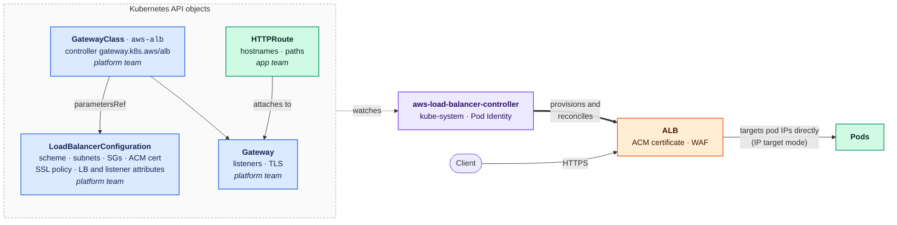

# `eks-gateway`

Kubernetes **Gateway API** on EKS, implemented by the **AWS Load Balancer
Controller**. This is the replacement for ingress-nginx.

Installs the Gateway API CRDs, the controller, and ALB/NLB `GatewayClass`
resources wired to ACM certificates — so application teams write a `Gateway`
and an `HTTPRoute` and get a real ALB, with no annotations to memorise.

---

## Contents

- [Why Gateway API](#why-gateway-api)
- [How it works](#how-it-works)
- [Prerequisites](#prerequisites)
- [Quick start](#quick-start)
- [TLS and ACM](#tls-and-acm)
- [Using it as an application team](#using-it-as-an-application-team)
- [Migrating from ingress-nginx](#migrating-from-ingress-nginx)
- [CRD management](#crd-management)
- [Version compatibility](#version-compatibility)
- [Troubleshooting](#troubleshooting)
- [Generated reference](#requirements)

---

## Why Gateway API

`ingress-nginx` has been retired upstream. Beyond that, the Ingress API itself
was never expressive enough: everything beyond host and path routing lives in
controller-specific annotations, which are untyped, unvalidated and
unportable.

Gateway API fixes the structural problem by splitting one overloaded object
into three with different owners:

| Resource | Scope | Owner | Answers |
|---|---|---|---|
| `GatewayClass` | Cluster | Platform team | What kind of load balancer, with what defaults |
| `Gateway` | Namespace | Platform team | Listeners, ports, TLS, who may attach |
| `HTTPRoute` / `GRPCRoute` / `TCPRoute` | Namespace | Application team | Where does this traffic go |

The practical consequence: an application team can no longer accidentally
change the TLS policy or the scheme of a shared load balancer, because those
fields are not in the object they own.

### Why the AWS Load Balancer Controller, and not Istio or Envoy Gateway

| | AWS LBC | Istio | Envoy Gateway |
|---|---|---|---|
| Data plane | ALB / NLB (AWS-managed) | In-cluster Envoy | In-cluster Envoy |
| You operate | nothing | Envoy fleet | Envoy fleet |
| Scaling | AWS handles it | Your problem | Your problem |
| TLS termination | ACM, keys never leave AWS | In-cluster Secret | In-cluster Secret |
| AWS integration | WAF, Shield, access logs, Global Accelerator | none | none |
| L7 mesh policy | no | yes | partial |

For north-south traffic on EKS, AWS LBC is **Tier 1**: AWS runs the data plane,
certificates stay in ACM, and WAF and access logs are a field away. Istio
remains the right tool for east-west mesh concerns and is available as
[`modules/istio`](../istio) — the two compose rather than compete.

---

## How it works



`LoadBalancerConfiguration` is the AWS-specific escape hatch. Attaching it to
the **GatewayClass** makes its settings the cluster default; attaching it to a
**Gateway** overrides them for that one entry point.

---

## Prerequisites

| Requirement | Detail |
|---|---|
| Terraform | `>= 1.10.0` |
| Providers | `helm >= 3.3`, `kubernetes >= 3.5`, `kubectl (alekc) >= 3.0`, `http >= 3.4` |
| Cluster | EKS with a Pod Identity association for the controller's service account — created by [`modules/eks`](../eks) |
| Subnets | Tagged `kubernetes.io/role/elb` (public) and `kubernetes.io/role/internal-elb` (private) |
| Network | The machine running Terraform must reach `github.com` to fetch CRD manifests, or you must set `crd_manifest_urls` to an internal mirror |
| ACM | A certificate in the **same region** as the cluster, for HTTPS listeners |

---

## Quick start

```hcl
module "gateway" {
  source = "git::https://github.com/pramodksahoo/terraform-eks-cluster.git//modules/eks-gateway?ref=eks-gateway-v1.0.0"

  cluster_name = "platform-prod"
  region       = "eu-central-1"
  vpc_id       = module.networking.vpc_id

  gateway_api_version = "v1.6.0"

  create_default_gateway_classes = true
  default_scheme                 = "internet-facing"
  default_certificate_arn        = aws_acm_certificate.public.arn
  default_ssl_policy             = "ELBSecurityPolicy-TLS13-1-2-2021-06"

  enable_access_logs = true
  access_logs_bucket = "my-elb-logs"

  tags = { Environment = "prod" }
}
```

---

## TLS and ACM

> **The controller does not read certificates from a Gateway listener's
> `certificateRefs`.** This trips up everyone arriving from other Gateway API
> implementations. ACM certificates attach through
> `LoadBalancerConfiguration.spec.listenerConfigurations[].defaultCertificate`.

This module wires that for you:

- `default_certificate_arn` → the default certificate on the HTTPS listener of
  the default `GatewayClass`.
- `load_balancer_configurations[*].listeners[*].certificate_arn` → per-Gateway
  certificates, with `additional_cert_arns` for SNI.

The private key never leaves ACM — there is no TLS Secret in the cluster to
leak, rotate, or forget to rotate.

```hcl
load_balancer_configurations = {
  tenant-a = {
    namespace = "tenant-a"
    scheme    = "internet-facing"

    listeners = [{
      protocol_port        = "HTTPS:443"
      certificate_arn      = aws_acm_certificate.tenant_a.arn
      additional_cert_arns = [aws_acm_certificate.tenant_a_alt.arn]
      ssl_policy           = "ELBSecurityPolicy-TLS13-1-2-2021-06"
    }]
  }
}
```

---

## Using it as an application team

You need two objects. Neither lets you change the load balancer's scheme or TLS
policy — that is the point.

```yaml
apiVersion: gateway.networking.k8s.io/v1
kind: Gateway
metadata:
  name: team-a
  namespace: team-a
spec:
  gatewayClassName: aws-alb          # from the module output
  listeners:
    - name: https
      protocol: HTTPS
      port: 443
      hostname: "*.team-a.example.com"
      allowedRoutes:
        namespaces:
          from: Same
---
apiVersion: gateway.networking.k8s.io/v1
kind: HTTPRoute
metadata:
  name: api
  namespace: team-a
spec:
  parentRefs:
    - name: team-a
  hostnames:
    - api.team-a.example.com
  rules:
    - matches:
        - path:
            type: PathPrefix
            value: /v1
      backendRefs:
        - name: api
          port: 8080
```

DNS is published automatically if external-dns is enabled in
[`modules/eks-addons`](../eks-addons) with `gateway-httproute` in its sources.

---

## Migrating from ingress-nginx

Both can run side by side: keep your Ingress objects while you move hostnames
across one at a time.

| ingress-nginx | Gateway API equivalent |
|---|---|
| `kubernetes.io/ingress.class: nginx` | `spec.gatewayClassName: aws-alb` |
| `spec.rules[].host` | `HTTPRoute.spec.hostnames` |
| `spec.rules[].http.paths[]` | `HTTPRoute.spec.rules[].matches[].path` |
| `nginx.ingress.kubernetes.io/rewrite-target` | `filters[].type: URLRewrite` |
| `nginx.ingress.kubernetes.io/canary-weight` | `backendRefs[].weight` — native, not an annotation |
| `nginx.ingress.kubernetes.io/ssl-redirect` | HTTP listener with a `RequestRedirect` filter |
| `nginx.ingress.kubernetes.io/configuration-snippet` | No equivalent, by design. Use a typed filter or an Istio `EnvoyFilter` |
| `spec.tls[].secretName` | `LoadBalancerConfiguration` → `defaultCertificate` (ACM) |

Full walkthrough: [`docs/gateway-api-migration.md`](../../docs/gateway-api-migration.md).

---

## CRD management

Three CRD sets are installed, as explicit `kubectl_manifest` resources rather
than being left to Helm:

1. **Gateway API** (`gateway.networking.k8s.io`) — `Gateway`, `GatewayClass`,
   `HTTPRoute`, `GRPCRoute`, `TCPRoute`, `UDPRoute`, `TLSRoute`.
2. **Controller CRDs** (`elbv2.k8s.aws`) — `TargetGroupBinding`,
   `IngressClassParams`.
3. **Controller Gateway CRDs** (`gateway.k8s.aws`) —
   `LoadBalancerConfiguration`, `TargetGroupConfiguration`,
   `ListenerRuleConfiguration`.

**Why not let Helm do it.** Helm installs a chart's bundled CRDs on first
install and never touches them again. A chart upgrade therefore leaves the old
schemas in place, and newly added fields are accepted by the API server and
silently discarded — a failure mode with no error message at all. Managing them
as resources means upgrades actually apply. The chart is installed with
`skip_crds = true` accordingly.

Manifests are fetched from **immutable, tag-pinned** URLs, never a branch. For
air-gapped environments, point `crd_manifest_urls` at an internal mirror.

Deleting a CRD deletes every object of that kind, so removing this module does
not cascade into destroying every Gateway in the cluster.

---

## Version compatibility

| Component | Pinned | Note |
|---|---|---|
| Chart `aws-load-balancer-controller` | `3.6.2` | Chart and app version aligned since 3.x |
| Gateway API CRDs | `v1.6.0` | The version the controller is **built and conformance-tested against**. Newer spec releases exist; pin to this one |
| `ALBGatewayAPI` / `NLBGatewayAPI` feature gates | `true` | Already the default in 3.6.x. Set explicitly so behaviour survives a default change |

From Gateway API v1.6.0, `TCPRoute` and `UDPRoute` are in the **standard**
channel, so L4 routing no longer needs the experimental CRDs.

The controller decides which Gateway controllers to enable by **detecting the
CRDs at startup** — which is why the Helm release depends on the CRD resources
here. If you ever install CRDs after the controller, restart it.

---

## Troubleshooting

| Symptom | Cause | Fix |
|---|---|---|
| `GatewayClass` not `Accepted` | Controller started before the CRDs existed | `kubectl -n kube-system rollout restart deploy/aws-load-balancer-controller` |
| No ALB created | Subnets missing `kubernetes.io/role/elb` | Tag them |
| ALB created but 503 on every request | No `HTTPRoute` attached, or `allowedRoutes` forbids the route's namespace | Check `kubectl describe gateway` |
| HTTPS listener rejected | Certificate referenced via `certificateRefs` | Move the ARN to `LoadBalancerConfiguration` `defaultCertificate` |
| `AccessDenied` in controller logs | Pod Identity association missing, or an IRSA annotation is overriding it | Confirm the SA has **no** `eks.amazonaws.com/role-arn` annotation |
| CRD fetch fails during plan | No egress to GitHub | Set `crd_manifest_urls` to an internal mirror |

---

## Examples

| Example | Description |
|---|---|
| [`complete`](examples/complete) | Controller, GatewayClasses and a public ACM-backed Gateway |

---

<!-- BEGIN_TF_DOCS -->
## Requirements

| Name | Version |
|------|---------|
| <a name="requirement_terraform"></a> [terraform](#requirement\_terraform) | >= 1.10.0 |
| <a name="requirement_helm"></a> [helm](#requirement\_helm) | >= 3.3.0, < 4.0.0 |
| <a name="requirement_http"></a> [http](#requirement\_http) | >= 3.4.0 |
| <a name="requirement_kubectl"></a> [kubectl](#requirement\_kubectl) | >= 3.0.0, < 4.0.0 |
| <a name="requirement_kubernetes"></a> [kubernetes](#requirement\_kubernetes) | >= 3.5.0, < 4.0.0 |

## Providers

| Name | Version |
|------|---------|
| <a name="provider_helm"></a> [helm](#provider\_helm) | >= 3.3.0, < 4.0.0 |
| <a name="provider_http"></a> [http](#provider\_http) | >= 3.4.0 |
| <a name="provider_kubectl"></a> [kubectl](#provider\_kubectl) | >= 3.0.0, < 4.0.0 |
| <a name="provider_kubernetes"></a> [kubernetes](#provider\_kubernetes) | >= 3.5.0, < 4.0.0 |

## Resources

| Name | Type |
|------|------|
| [helm_release.controller](https://registry.terraform.io/providers/hashicorp/helm/latest/docs/resources/release) | resource |
| [kubectl_manifest.alb_gateway_class](https://registry.terraform.io/providers/alekc/kubectl/latest/docs/resources/manifest) | resource |
| [kubectl_manifest.crds](https://registry.terraform.io/providers/alekc/kubectl/latest/docs/resources/manifest) | resource |
| [kubectl_manifest.default_alb_config](https://registry.terraform.io/providers/alekc/kubectl/latest/docs/resources/manifest) | resource |
| [kubectl_manifest.default_nlb_config](https://registry.terraform.io/providers/alekc/kubectl/latest/docs/resources/manifest) | resource |
| [kubectl_manifest.gateway](https://registry.terraform.io/providers/alekc/kubectl/latest/docs/resources/manifest) | resource |
| [kubectl_manifest.load_balancer_configuration](https://registry.terraform.io/providers/alekc/kubectl/latest/docs/resources/manifest) | resource |
| [kubectl_manifest.nlb_gateway_class](https://registry.terraform.io/providers/alekc/kubectl/latest/docs/resources/manifest) | resource |
| [kubernetes_service_account_v1.controller](https://registry.terraform.io/providers/hashicorp/kubernetes/latest/docs/resources/service_account_v1) | resource |
| [http_http.crds](https://registry.terraform.io/providers/hashicorp/http/latest/docs/data-sources/http) | data source |
| [kubectl_file_documents.crds](https://registry.terraform.io/providers/alekc/kubectl/latest/docs/data-sources/file_documents) | data source |

## Inputs

| Name | Description | Type | Default | Required |
|------|-------------|------|---------|:--------:|
| <a name="input_cluster_name"></a> [cluster\_name](#input\_cluster\_name) | Name of the EKS cluster. The AWS Load Balancer Controller uses it for resource tagging and for discovering subnets and security groups. | `string` | n/a | yes |
| <a name="input_region"></a> [region](#input\_region) | AWS region the cluster runs in. | `string` | n/a | yes |
| <a name="input_vpc_id"></a> [vpc\_id](#input\_vpc\_id) | VPC the cluster runs in. Supplying it explicitly saves the controller an EC2 describe call on every start and removes a failure mode on restricted IAM policies. | `string` | n/a | yes |
| <a name="input_access_logs_bucket"></a> [access\_logs\_bucket](#input\_access\_logs\_bucket) | S3 bucket receiving load balancer access logs. Required when enable\_access\_logs is true. The bucket policy must already permit the regional ELB log delivery principal. | `string` | `null` | no |
| <a name="input_access_logs_prefix"></a> [access\_logs\_prefix](#input\_access\_logs\_prefix) | Key prefix for load balancer access logs. | `string` | `null` | no |
| <a name="input_alb_gateway_class_name"></a> [alb\_gateway\_class\_name](#input\_alb\_gateway\_class\_name) | Name of the ALB-backed GatewayClass. Application teams reference this from spec.gatewayClassName. | `string` | `"aws-alb"` | no |
| <a name="input_chart_repository"></a> [chart\_repository](#input\_chart\_repository) | Helm repository serving the AWS Load Balancer Controller chart. | `string` | `"https://aws.github.io/eks-charts"` | no |
| <a name="input_chart_version"></a> [chart\_version](#input\_chart\_version) | aws-load-balancer-controller chart version. Chart and app version are aligned from 3.x onwards. | `string` | `"3.6.2"` | no |
| <a name="input_controller_values"></a> [controller\_values](#input\_controller\_values) | Additional values merged over the computed controller chart values. | `any` | `{}` | no |
| <a name="input_crd_manifest_urls"></a> [crd\_manifest\_urls](#input\_crd\_manifest\_urls) | Override the URLs the CRD manifests are fetched from, as a list.<br/><br/>By default the module derives immutable, tag-pinned GitHub release URLs from<br/>gateway\_api\_version and chart\_version. Override this to serve the manifests from an<br/>internal mirror, which is required in an air-gapped environment and is good<br/>practice anywhere that an external fetch during plan is unacceptable.<br/><br/>Never point these at a branch such as `main`: the content would change underneath<br/>the configuration with no version bump and no diff. | `list(string)` | `null` | no |
| <a name="input_create_default_gateway_classes"></a> [create\_default\_gateway\_classes](#input\_create\_default\_gateway\_classes) | Create the `aws-alb` and `aws-nlb` GatewayClasses.<br/><br/>GatewayClasses are cluster-scoped and are the platform team's contract with<br/>application teams: the application team writes a Gateway referencing a class name<br/>and never needs to know the controller name or the AWS wiring behind it. | `bool` | `true` | no |
| <a name="input_default_certificate_arn"></a> [default\_certificate\_arn](#input\_default\_certificate\_arn) | ACM certificate ARN used as the default certificate on HTTPS listeners created<br/>through the default GatewayClasses.<br/><br/>Note that the AWS Load Balancer Controller does not read certificates from a Gateway<br/>listener's certificateRefs — ACM certificates are referenced here, on the<br/>LoadBalancerConfiguration, instead. | `string` | `null` | no |
| <a name="input_default_ip_address_type"></a> [default\_ip\_address\_type](#input\_default\_ip\_address\_type) | IP address type for load balancers created through the default GatewayClasses. | `string` | `"ipv4"` | no |
| <a name="input_default_listener_attributes"></a> [default\_listener\_attributes](#input\_default\_listener\_attributes) | Listener attributes applied to the default HTTPS listener, as a key/value map. | `map(string)` | <pre>{<br/>  "routing.http.response.server.enabled": "false"<br/>}</pre> | no |
| <a name="input_default_load_balancer_attributes"></a> [default\_load\_balancer\_attributes](#input\_default\_load\_balancer\_attributes) | Load balancer attributes applied through the default GatewayClasses, as a key/value map. Rendered into the controller's list-of-objects form by the module. | `map(string)` | <pre>{<br/>  "deletion_protection.enabled": "false",<br/>  "routing.http.drop_invalid_header_fields.enabled": "true",<br/>  "routing.http.xff_client_port.enabled": "true"<br/>}</pre> | no |
| <a name="input_default_scheme"></a> [default\_scheme](#input\_default\_scheme) | Default scheme for load balancers created through the default GatewayClasses.<br/><br/>  "internal"        - reachable only from inside the VPC and peered networks.<br/>  "internet-facing" - public.<br/><br/>"internal" is the default here and in the controller itself. Making a Gateway<br/>public should be a deliberate, reviewable act, not something that happens because<br/>a field was omitted. | `string` | `"internal"` | no |
| <a name="input_default_ssl_policy"></a> [default\_ssl\_policy](#input\_default\_ssl\_policy) | TLS security policy for HTTPS listeners.<br/><br/>The default permits TLS 1.2 and 1.3 only. Policies including TLS 1.0 and 1.1 fail<br/>most compliance baselines and should not be reintroduced without a specific,<br/>documented legacy client. | `string` | `"ELBSecurityPolicy-TLS13-1-2-2021-06"` | no |
| <a name="input_default_subnet_selector_tags"></a> [default\_subnet\_selector\_tags](#input\_default\_subnet\_selector\_tags) | Tags used to discover the subnets load balancers are placed in. Null falls back to<br/>the controller's built-in discovery, which relies on the kubernetes.io/role/elb and<br/>kubernetes.io/role/internal-elb subnet tags applied by the networking module. | `map(string)` | `null` | no |
| <a name="input_enable_access_logs"></a> [enable\_access\_logs](#input\_enable\_access\_logs) | Write load balancer access logs to S3. Access logs are the only record of who reached the cluster from outside and are usually a compliance requirement. | `bool` | `false` | no |
| <a name="input_enable_waf"></a> [enable\_waf](#input\_enable\_waf) | Allow the controller to manage WAFv2 and Shield associations on the load balancers it creates. Requires the matching IAM permissions; leave off if they are not granted. | `bool` | `false` | no |
| <a name="input_gateway_api_channel"></a> [gateway\_api\_channel](#input\_gateway\_api\_channel) | Which Gateway API CRD channel to install.<br/><br/>  "standard"     - the stable surface. From v1.6.0 this includes TCPRoute and<br/>                   UDPRoute, so L4 routing no longer needs the experimental channel.<br/>  "experimental" - adds alpha resources such as BackendTLSPolicy. Expect breaking<br/>                   changes between releases. | `string` | `"standard"` | no |
| <a name="input_gateway_api_version"></a> [gateway\_api\_version](#input\_gateway\_api\_version) | Gateway API release whose CRDs are installed, e.g. "v1.6.0".<br/><br/>Pin this to the version the controller is built against rather than to the newest<br/>release. AWS Load Balancer Controller 3.6.x is built and conformance-tested against<br/>Gateway API v1.6.0. | `string` | `"v1.6.0"` | no |
| <a name="input_gateway_class_defaults_namespace"></a> [gateway\_class\_defaults\_namespace](#input\_gateway\_class\_defaults\_namespace) | Namespace holding the LoadBalancerConfiguration objects that the default GatewayClasses point at. A platform-owned namespace keeps application teams from editing cluster-wide load balancer defaults. | `string` | `"kube-system"` | no |
| <a name="input_gateways"></a> [gateways](#input\_gateways) | Gateway objects to create, keyed by name. Most teams will create Gateways from their<br/>own application repositories rather than from here; this exists for the shared,<br/>platform-owned entry points. | <pre>map(object({<br/>    namespace                   = string<br/>    gateway_class_name          = string<br/>    load_balancer_configuration = optional(string)<br/>    annotations                 = optional(map(string), {})<br/>    labels                      = optional(map(string), {})<br/>    listeners = list(object({<br/>      name                = string<br/>      protocol            = string<br/>      port                = number<br/>      hostname            = optional(string)<br/>      allowed_routes_from = optional(string, "Same")<br/>    }))<br/>  }))</pre> | `{}` | no |
| <a name="input_helm_timeout"></a> [helm\_timeout](#input\_helm\_timeout) | Seconds to wait for the controller release to become ready. | `number` | `600` | no |
| <a name="input_load_balancer_configurations"></a> [load\_balancer\_configurations](#input\_load\_balancer\_configurations) | Additional LoadBalancerConfiguration objects, keyed by name. Use these for Gateways<br/>that need settings different from the GatewayClass defaults, for example a public<br/>Gateway in an otherwise internal cluster.<br/><br/>Each entry mirrors the controller's gateway.k8s.aws/v1 LoadBalancerConfiguration<br/>spec. Null fields are omitted from the manifest so the controller's own defaults<br/>apply. | <pre>map(object({<br/>    namespace                = optional(string)<br/>    scheme                   = optional(string)<br/>    ip_address_type          = optional(string)<br/>    load_balancer_name       = optional(string)<br/>    subnet_ids               = optional(list(string))<br/>    subnet_selector_tags     = optional(map(string))<br/>    security_group_ids       = optional(list(string))<br/>    security_group_prefixes  = optional(list(string))<br/>    source_ranges            = optional(list(string))<br/>    load_balancer_attributes = optional(map(string), {})<br/>    merging_mode             = optional(string)<br/>    tags                     = optional(map(string), {})<br/>    listeners = optional(list(object({<br/>      protocol_port        = string<br/>      certificate_arn      = optional(string)<br/>      additional_cert_arns = optional(list(string))<br/>      ssl_policy           = optional(string)<br/>      alpn_policy          = optional(string)<br/>      attributes           = optional(map(string), {})<br/>    })), [])<br/>  }))</pre> | `{}` | no |
| <a name="input_manage_crds"></a> [manage\_crds](#input\_manage\_crds) | Install and manage the Gateway API and AWS Load Balancer Controller CRDs from this<br/>module.<br/><br/>This is strongly recommended. Helm installs a chart's bundled CRDs on first install<br/>and then never touches them again, so a chart version bump leaves the old CRD<br/>schemas in place and new fields are silently dropped. Managing them as explicit<br/>resources means upgrades actually apply.<br/><br/>Set to false only when CRDs are owned by a separate cluster-bootstrap process. | `bool` | `true` | no |
| <a name="input_namespace"></a> [namespace](#input\_namespace) | Namespace for the controller. Must match the Pod Identity association created in modules/eks. | `string` | `"kube-system"` | no |
| <a name="input_nlb_gateway_class_name"></a> [nlb\_gateway\_class\_name](#input\_nlb\_gateway\_class\_name) | Name of the NLB-backed GatewayClass. | `string` | `"aws-nlb"` | no |
| <a name="input_node_selector"></a> [node\_selector](#input\_node\_selector) | Node selector for the controller. It belongs on the statically provisioned system node group: it is in the path of every load balancer reconcile. | `map(string)` | <pre>{<br/>  "node.kubernetes.io/role": "system"<br/>}</pre> | no |
| <a name="input_replica_count"></a> [replica\_count](#input\_replica\_count) | Controller replicas. The controller is active/passive via leader election, so more than one buys failover rather than throughput. | `number` | `2` | no |
| <a name="input_service_account_name"></a> [service\_account\_name](#input\_service\_account\_name) | Service account the controller runs as. Must match the Pod Identity association<br/>created in modules/eks.<br/><br/>The service account is created by this module rather than the chart so that no<br/>IRSA eks.amazonaws.com/role-arn annotation is ever attached: an IRSA annotation<br/>takes precedence over Pod Identity and would silently route the controller to the<br/>wrong credential source. | `string` | `"aws-load-balancer-controller"` | no |
| <a name="input_tags"></a> [tags](#input\_tags) | Tags applied to the AWS load balancers the controller provisions. | `map(string)` | `{}` | no |
| <a name="input_tolerations"></a> [tolerations](#input\_tolerations) | Tolerations for the controller. Must match the taint on the baseline system ASG. | <pre>list(object({<br/>    key      = optional(string)<br/>    operator = optional(string)<br/>    value    = optional(string)<br/>    effect   = optional(string)<br/>  }))</pre> | <pre>[<br/>  {<br/>    "effect": "NoSchedule",<br/>    "key": "CriticalAddonsOnly",<br/>    "operator": "Equal",<br/>    "value": "true"<br/>  }<br/>]</pre> | no |

## Outputs

| Name | Description |
|------|-------------|
| <a name="output_alb_controller_name"></a> [alb\_controller\_name](#output\_alb\_controller\_name) | GatewayClass controllerName implemented by the ALB controller. |
| <a name="output_alb_gateway_class_name"></a> [alb\_gateway\_class\_name](#output\_alb\_gateway\_class\_name) | Name of the ALB-backed GatewayClass. Reference from spec.gatewayClassName on a Gateway carrying HTTPRoute or GRPCRoute. |
| <a name="output_controller_chart_version"></a> [controller\_chart\_version](#output\_controller\_chart\_version) | AWS Load Balancer Controller chart version installed. |
| <a name="output_controller_namespace"></a> [controller\_namespace](#output\_controller\_namespace) | Namespace the AWS Load Balancer Controller runs in. |
| <a name="output_controller_service_account_name"></a> [controller\_service\_account\_name](#output\_controller\_service\_account\_name) | Service account the controller runs as. Must match the Pod Identity association in modules/eks. |
| <a name="output_gateway_api_version"></a> [gateway\_api\_version](#output\_gateway\_api\_version) | Gateway API release whose CRDs were installed. |
| <a name="output_gateway_class_defaults_namespace"></a> [gateway\_class\_defaults\_namespace](#output\_gateway\_class\_defaults\_namespace) | Namespace holding the LoadBalancerConfiguration objects referenced by the default GatewayClasses. |
| <a name="output_gateway_names"></a> [gateway\_names](#output\_gateway\_names) | Names of the Gateway objects created by this module. |
| <a name="output_load_balancer_configuration_names"></a> [load\_balancer\_configuration\_names](#output\_load\_balancer\_configuration\_names) | Names of the caller-defined LoadBalancerConfiguration objects created by this module. |
| <a name="output_nlb_controller_name"></a> [nlb\_controller\_name](#output\_nlb\_controller\_name) | GatewayClass controllerName implemented by the NLB controller. |
| <a name="output_nlb_gateway_class_name"></a> [nlb\_gateway\_class\_name](#output\_nlb\_gateway\_class\_name) | Name of the NLB-backed GatewayClass. Reference from spec.gatewayClassName on a Gateway carrying TCPRoute, UDPRoute or TLSRoute. |
<!-- END_TF_DOCS -->
